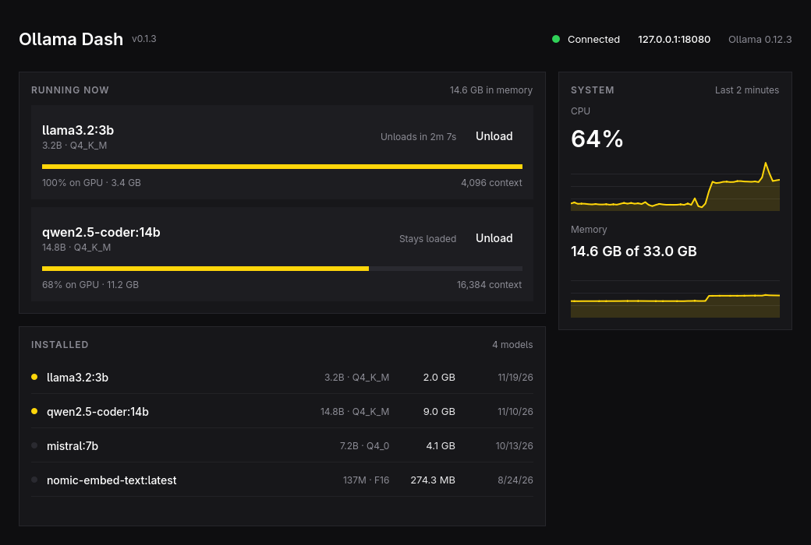

# Ollama Dash



A live dashboard for a local or remote [Ollama](https://ollama.com) server, built with Qt Quick for Omarchy. It follows the desktop theme, and speaks English, Spanish (Mexico), Italian and Hungarian, following the language set in Omarchy.

- Models in memory right now, with how much of each sits on the GPU, its context size, and a countdown to unload
- An Unload button per loaded model
- Click any model for its details: capabilities, architecture, parameters, layers, max context, size, licence, default parameters and template
- Every installed model, newest first, with the loaded ones marked
- CPU and memory graphs for this computer (hidden when watching a remote host)

## Run

```sh
bin/build
build/ollamadash
```

It talks to the host you last chose, else `$OLLAMA_HOST`, else `127.0.0.1:11434`. Press `H` (or click the address in the header) to pick another Ollama server; the choice is saved in `~/.config/ollamadash/ollamadash.conf`.

`bin/install` builds the package with `makepkg -fsi` so it shows up in the launcher. `bin/test` runs the unit tests offscreen.

## Shortcuts

| Key | Action |
| --- | --- |
| Space or R | Refresh now |
| ? | Show or hide the shortcuts |
| H | Change the Ollama host |
| Q | Quit |

## Notes

Ollama doesn't report tokens per second, so there is no throughput graph. GPU memory comes from Ollama's own `/api/ps` numbers rather than vendor tools.

## Languages

The app follows Omarchy's language setting (`~/.config/omarchy/language`) and ships only languages Omarchy itself supports. Catalogs live in `src/i18n/` (`es-MX`, `it`, `hu`); a missing string falls back to English. `bin/test` checks that every catalog has the same strings and keeps their placeholders.

MIT licensed (see [LICENSE](LICENSE)). The theme and translator code come from Omacut and Monologue; see [NOTICE](NOTICE).
